# Instalación de clientes para tres SGBD
### 1. Oracle Database 23ai Free
Instalamos un JDK compatible con la versión de SQL Developer descargada.
```
sudo apt install default-jdk unzip
java --version
```
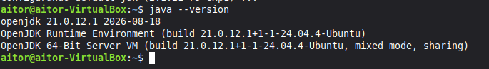  
A continuación, descargaremos el ZIP de SQL Developer y lo descomprimremos en /opt  
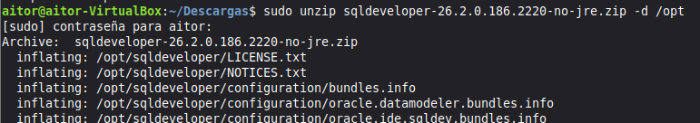  
Lo ejecutamos:  
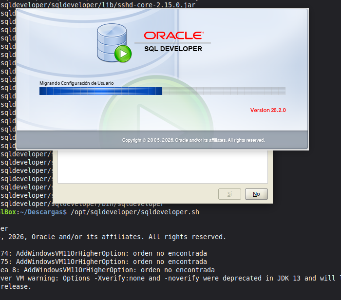  
Creamos una conexión a Oracle con el usuario orauser, puerto 1521 y nombre de servicio FREEPDB1.  
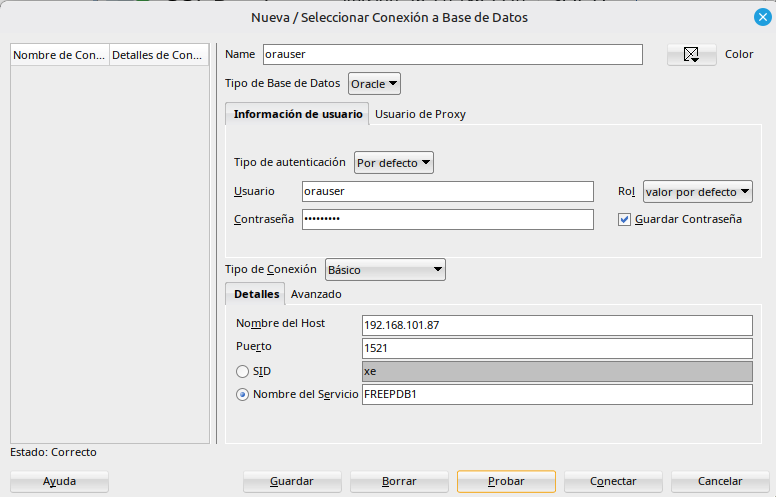  
### 2. VS Code y extensión SQL Developer
El siguiente paso será descargar el paquete .deb actual de VS Code, e instalar una extension para oracle:    
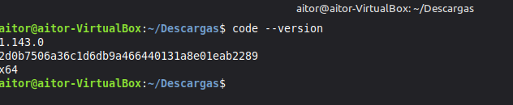  
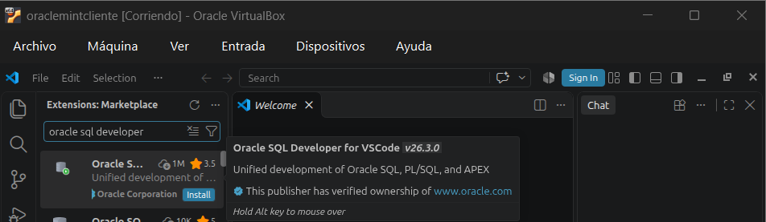  
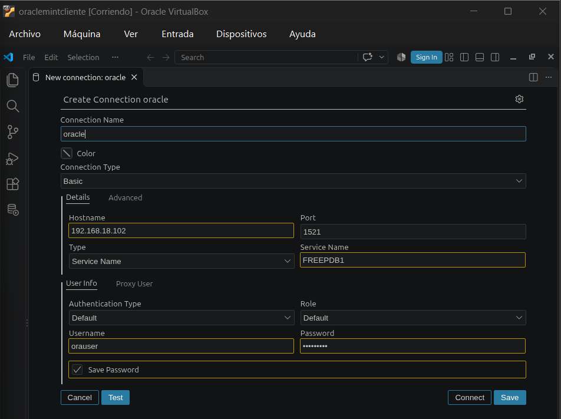  
Comprobamos el funcionamiento:  
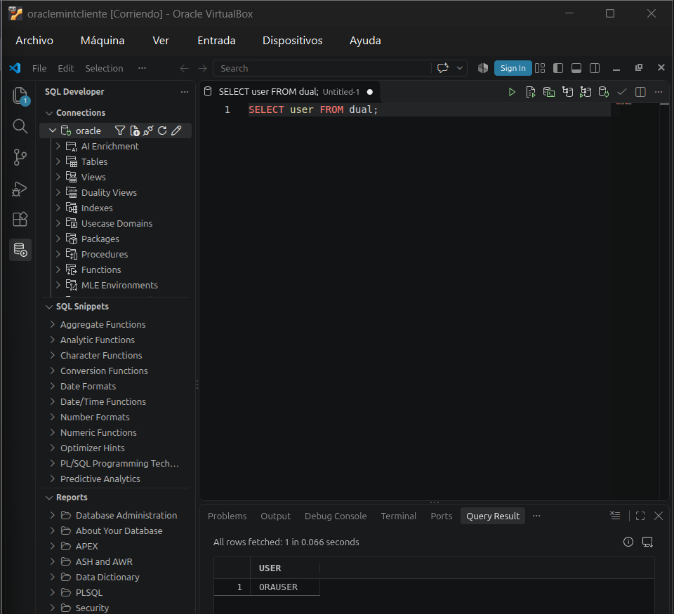  
### 3. SQL Plus
Descargaremos los ZIP Basic y sqlplus de la version 23.26.4.0.0 y hacemos conexión  
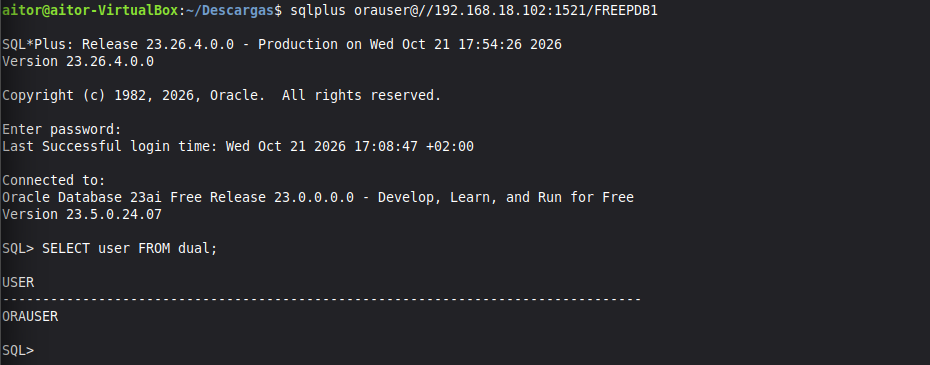  
### 4. SQLcl 
Instalamos java  
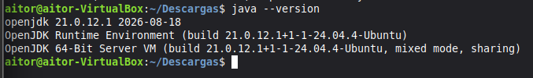  
Y nos descargamos el ZIP de SQLcl  
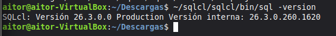  
Iniciamos una nueva terminal e iniciamos una conexión  
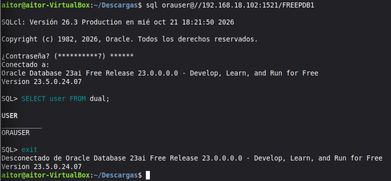  
### 5. PostgreSQL
Instalamos PostgreSQL  
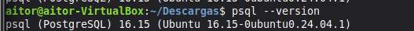  
He tenido que editar el fichero de configuración de PostgreSQL para que la línea comentada de que escuche a todos esté operativa (descomentada) y el fichero para el usuario pguser para autorizarle acceso, los ficheros son estos: **/etc/postgresql/16/main/pg_hba.conf** y **/etc/postgresql/16/main/postgresql.conf**  
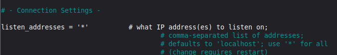  
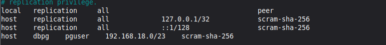  
Una vez editados los ficheros de configuración, reiniciamos el servicio.  
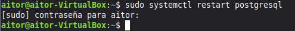  
Y hacemos la conexión  
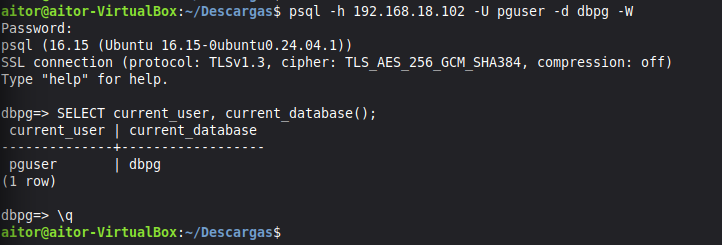  
### 6. Cliente gráfico pgAdmin 4
(no hecho)
### 7. Maria DB
Instalamos y hacemos una conexión  
  
Tenemos que editar la misma configuración que en PostgreSQL, que deje la conexión en todas las redes y permitir la autorización al usuario  
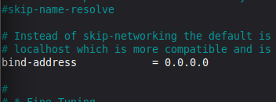  
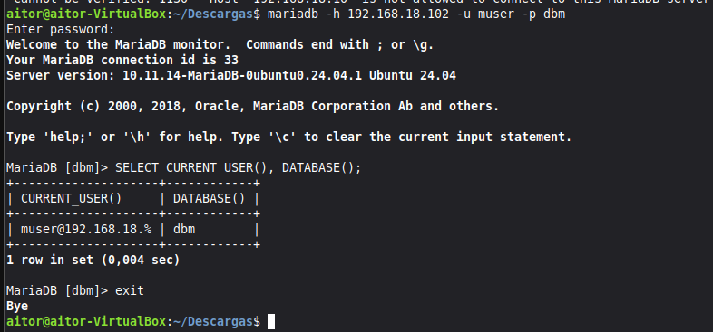  
### 8. Clientes multi-SGBD
#### 8.1 DBeaver
Descargamos el paquete DEB actual  
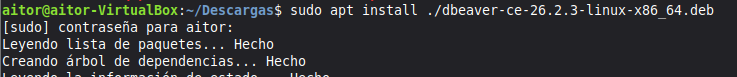  
iniciamos tres conexiones  
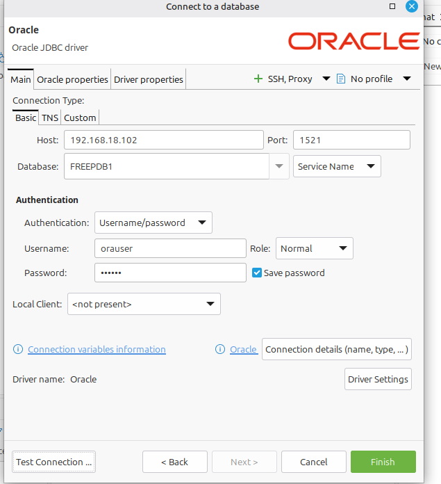  
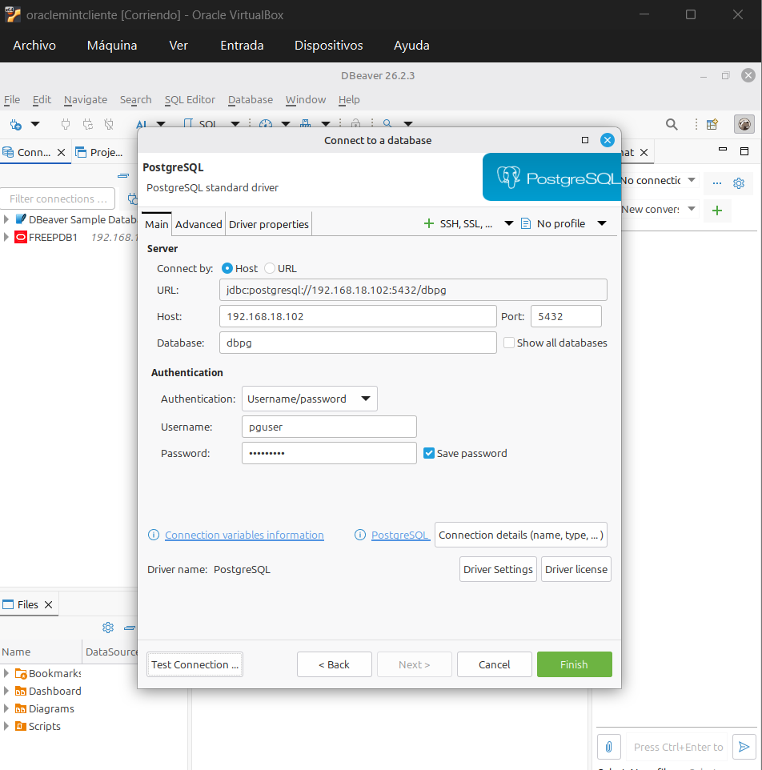  
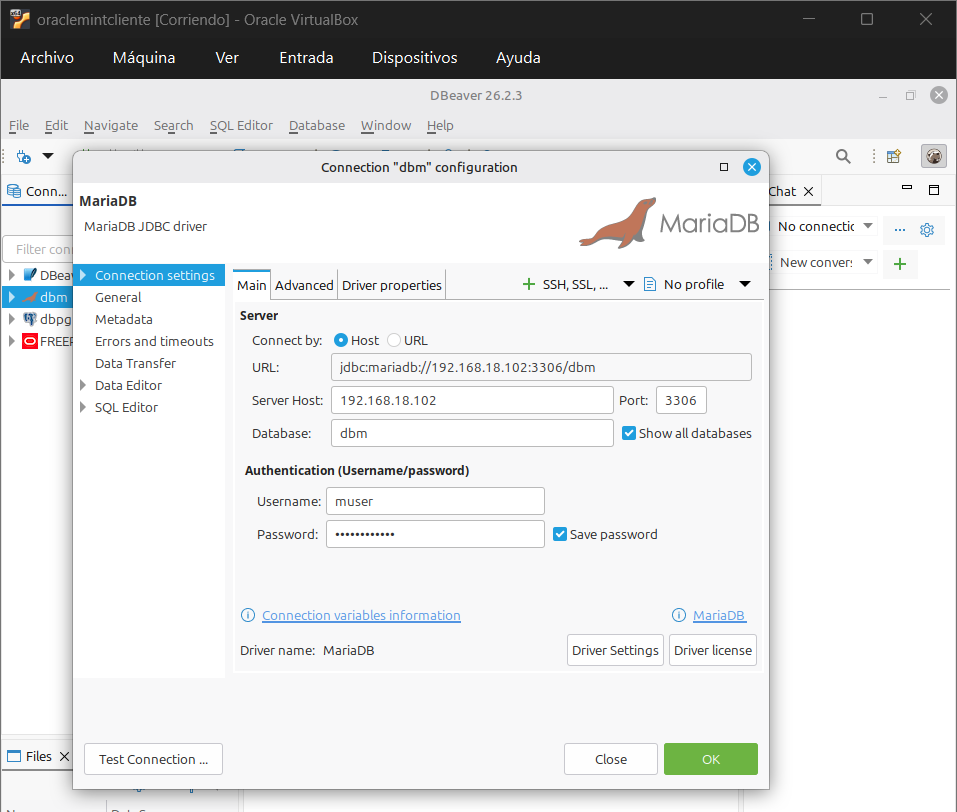  
He probado una consulta a cada una y funcionan correctamente.  
#### 8.2 Adminer
Instalamos Adminer  
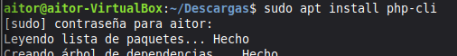  
  
He instalado las extensiones y comprobaremos la conexión  
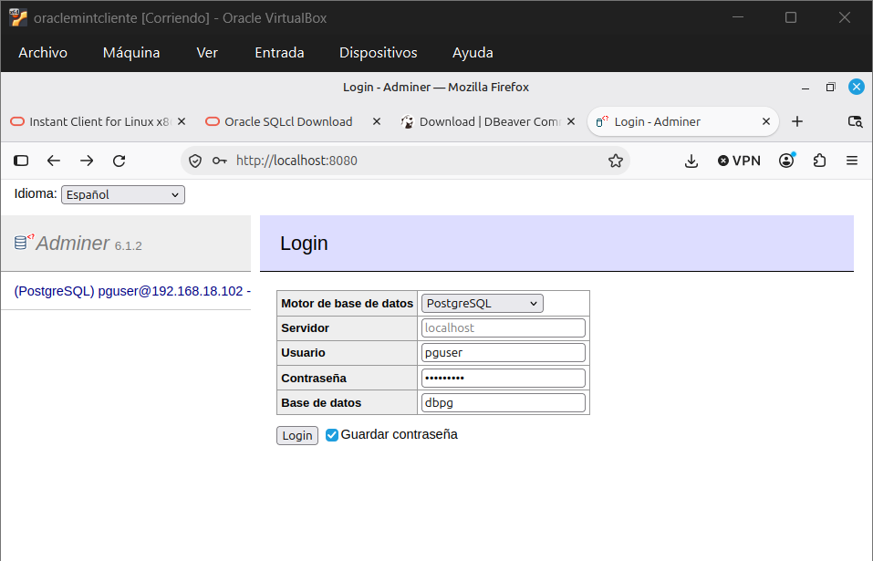  
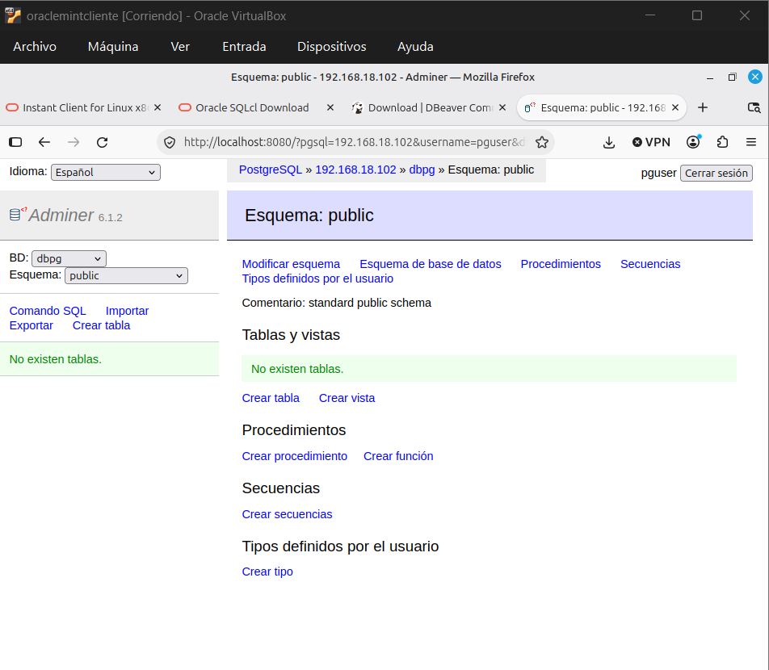
